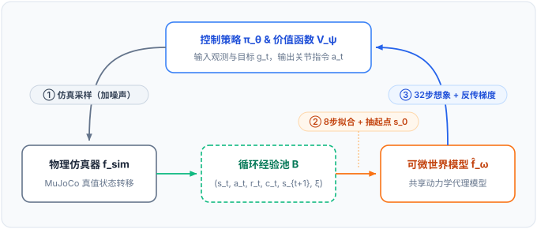

人形全身动作跟踪（mimic）扩动作库时，动作从几十段涨到十几万段，**机器人本体和平地接触的物理规律其实没有变**，变多的只是参考轨迹。UC Berkeley 提出的 [SuperMimic][supermimic]（CoRL 2026 Oral）抓住了这个共享动力学假设：不再每加新动作都靠无模型 PPO 在仿真器里盲目采样，而是把共享的物理状态转移显式学成一个**可微世界模型 `f̂_ω`**，顺着模型反向传播梯度来训控制器 `π_θ`。

结果很直观：单张 H100 跑 **3 小时**，就能在约 **13 万段**参考动作上训出一个通用跟踪控制器，并直接迁移到 Unitree G1 真机完成跳跃、侧滚和空翻。

下面把整套方法的交替训练闭环、冷启动里的四个关键数据流问题，以及证据边界拆开记一下。



### 1. 闭环里的四个关键问题

看这类“在线学模型 + 模型内反传训策略”的框架，最容易在冷启动和数据流向上绕晕。时刻区分**控制策略 `π_θ`**、**可微世界模型 `f̂_ω`** 和**物理仿真器 `f_sim`（MuJoCo Warp）**三个角色，逻辑就非常顺：

1. **第一个策略 `π_0` 是哪来的？**  
   直接从一个**尚未学会控制的随机初始化策略**起步，不需要先拿训好的 PPO 策略垫底。哪怕最初动作很差、机器人一动就摔，物理仿真器照样能算出真实的物理转移 `(s_t, a_t, s_{t+1})`。配合参考动作随机时间点重置（RSI），这些早期数据足够让世界模型开始学“给什么动作会导致什么状态变化”。

2. **更新世界模型前，世界模型也是随机的吗？会不会死锁？**  
   从零训练时，世界模型一开始也是随机参数，但**不会出现循环依赖死锁**。因为**第一步采集数据完全不经过世界模型**：最初由随机策略 `π_0` 在物理仿真器 `f_sim` 中交互生成首批真实转移 `B_0`，用 `B_0` 拟合出第一版世界模型 `f̂_1`，之后才在 `f̂_1` 里反传更新出 `π_1`。

3. **“训世界模型”和“训控制策略”的数据流有什么区别？**  
   两者的起点都来自循环经验池 `B`（即近期策略在物理仿真器里真实踩到过的状态），但**动作来源完全不同**：

| 阶段 | 状态起点 | 动作序列来源 | 后续状态怎么来 | 优化目标 |
| :--- | :--- | :--- | :--- | :--- |
| **② 训世界模型 `f̂_ω`** | 经验池真实状态 `s_t` | 回放经验池里**记录的旧动作** | 与仿真器记录的真值状态对齐 | 8 步自回归预测误差 |
| **③ 训控制策略 `π_θ`** | 经验池真实状态 `s_0` | 由**当前策略 `π_θ` 实时生成** | 由冻结的 `f̂_ω` 往前推演 32 步 | 32 步累积回报 + 末端价值 `V_ψ` |

4. **新策略训好后，再放回“真实模型”采数据、修正世界模型？**  
   对。这里放回的是**作为真值依据的物理仿真器 `f_sim`**（整套训练闭环都在仿真中完成，未用真机数据修正世界模型），被修正的是**可微世界模型 `f̂_ω`**。当策略更新到 `π_1`，会进入 `π_0` 没访问过的新状态区域，旧模型 `f̂_1` 在这些区域会产生预测偏差；因此必须用 `π_1` 回仿真器采出 `B_1`，补齐新状态分布并更新出 `f̂_2`：

```text
π_0 (随机) ──► 仿真器采 B_0 ──► 8步拟合 f̂_1 ──► 32步反传得 π_1 ──► 回仿真器采 B_1 ──► 修正 f̂_2 ──► ···
```

### 2. 关键设计与隐性代价

SuperMimic 能把短时域可微控制跑通到 13 万段动作，核心靠下面几处工程取舍：

| 关键设计 | 解决什么问题 | 付出的隐性代价 |
| :--- | :--- | :--- |
| **显式输入摩擦、质心偏移等参数 `ξ`** | 把环境随机性转化为已知条件，降低确定性预测难度 | 训练依赖仿真器特权信息 |
| **8 步自回归训练世界模型** | 让模型在自身预测状态上继续推演，抑制多步误差累积 | 不保证长时域或分布外状态稳定 |
| **32 步想象展开 + 末端价值 `V_ψ`** | 限制梯度反传深度，同时保留长期收益信号 | 引入价值函数估计偏差 |
| **软终止概率 `ĉ_t` + 取消根部速度冲击** | 避免硬终止截断梯度，避免突变状态破坏确定性拟合 | 模型的便利性反过来限制了抗冲击扰动设计 |

这里有一个必须分清的概念：**“解析梯度”指的是对学习到的代理模型 `f̂_ω` 精确求导，并不等于拿到了真实物理系统的无偏梯度。** 在接触切换边界附近，哪怕状态预测很准（`f̂(s,a) ≈ f(s,a)`），动作方向的偏导也可能失真（`∂f̂/∂a ≠ ∂f/∂a`）。

### 3. 怎么看论文的核心实验证据

- **真正硬核的证据是同条件对照与消融，而非“千倍加速”宣传数。** 论文拿单卡 H100 跑 3 小时（3 GPU-hours）对比 [SONIC][sonic] 的 128 张 L40 跑 168 小时（约 21,000 GPU-hours），中间混杂了硬件代差、数据规模（265h vs 611h）与历史实现差异。真正有说服力的是两组受控实验：
  1. **同条件 LAFAN1 对照（2.45 小时数据）**：SuperMimic 单卡 **1.2 小时**达到回报 **0.82**，而同配置的 PPO 在 8 卡、18 小时内最高停在 **0.72**。
  2. **PPO-WM 消融**：同样在学到的世界模型里采样，顺着模型做解析梯度反传比在世界模型里跑 PPO 省了 **64 倍**想象步数——说明**世界模型的价值不只是推理快，更在于提供了低方差的优化方向**。
- **“129,514 段动作零失败”衡量的是训练集覆盖率。** 附录写得很清楚：该评测在训练动作集上进行，关闭了观测噪声与域随机化，失败判据主要是根部高度与倾角不触发提前终止。其中最有信息量的是困难动作子集：SONIC 在 44 段翻转动作上全部失败，而 SuperMimic 全部完成。
- **方法定位：** 沿可微世界模型反传训控制器并非本文首创——2021 年的 [SuperTrack][supertrack] 已采用“经验池 + 8 步训模型 + 32 步训策略”，短窗口配末端价值源自 [SHAC][shac]，后续还有 [ControlVAE][controlvae] 与 [SuperDyno][superdyno]。SuperMimic 的真正贡献是**把这条路线推进到了百小时级人形动作库与 Unitree G1 真机部署**。

**一句话总结：** 当大量技能共享同一套底层动力学时，学一个能提供可靠梯度的可微世界模型，能把新增动作的边际训练成本压低一个数量级；但在多地形、未知物体接触等分布外场景下，代理模型的梯度可信度仍是下一步要啃的硬骨头。

## English

When scaling humanoid whole-body motion tracking from dozens of clips to over 100,000, **the underlying robot dynamics and flat-ground contact physics remain unchanged**—only the reference trajectories grow. [SuperMimic][supermimic] (UC Berkeley, CoRL 2026 Oral) exploits this shared-dynamics structure: instead of brute-forcing model-free PPO sampling for every new clip, it learns a single **differentiable world model `f̂_ω`** and updates the tracking policy `π_θ` via analytical gradients backpropagated through imagined rollouts.

On a single H100 GPU in **3 hours**, SuperMimic trains a universal controller across roughly **130,000 motion clips** and deploys zero-shot to a real Unitree G1 for jumps, cartwheels, and flips.

### 1. Four Key Questions on the Training Loop

Keeping three objects distinct—the **policy `π_θ`**, the **learned world model `f̂_ω`**, and the **ground-truth physics simulator `f_sim` (MuJoCo Warp)**—clarifies how the loop cold-starts and iterates:

1. **Where does the initial policy `π_0` come from?**  
   It starts from a **randomly initialized, untrained network**, not a pretrained PPO checkpoint. Even when `π_0` produces poor actions and falls immediately, `f_sim` yields valid physical transitions `(s_t, a_t, s_{t+1})`. Combined with Reference State Initialization (RSI) across motion frames, early rollouts provide enough signal to start fitting local dynamics.

2. **Is the world model also random at the start? Why doesn't it deadlock?**  
   Yes, `f̂_ω` starts randomly initialized when training from scratch, and **no circular deadlock occurs** because **step ① (data collection) bypasses the world model entirely**. `π_0` interacts directly with `f_sim` to populate the initial replay buffer `B_0`, which trains the first world model `f̂_1`, which then updates the policy to `π_1`.

3. **How do world-model training and policy training differ in data flow?**  
   Both draw initial states from the circular replay buffer `B` (real states visited in `f_sim`), but their **action sequences come from different sources**:

| Stage | Initial State | Action Sequence Source | Future States | Objective |
| :--- | :--- | :--- | :--- | :--- |
| **② World Model Fit (`f̂_ω`)** | Real buffer state `s_t` | Replays **recorded historical actions** from `B` | Matched against ground-truth `f_sim` states | 8-step autoregressive prediction loss |
| **③ Policy Update (`π_θ`)** | Real buffer state `s_0` | Generated live by **current policy `π_θ`** | Unrolled for 32 steps inside frozen `f̂_ω` | 32-step discounted return + terminal value `V_ψ` |

4. **Why send the updated policy back to the physics simulator?**  
   As `π_1` improves, it enters state regions never visited by `π_0`, where the old model `f̂_1` is inaccurate. Rolling out `π_1` in the ground-truth simulator `f_sim` collects fresh transitions `B_1` to correct `f̂_2`:

```text
π_0 (random) ──► Sim rollout B_0 ──► 8-step fit f̂_1 ──► 32-step backprop π_1 ──► Sim rollout B_1 ──► Refine f̂_2 ──► ···
```

### 2. Core Design Trade-offs & Evidence Boundaries

- **Privileged conditioning & perturbation trade-offs:** Explicitly feeding friction and CoM offsets `ξ` into `f̂_ω` makes deterministic transitions learnable, but requires simulator privileged parameters and led the authors to **remove random root velocity push perturbations** that break deterministic prediction.
- **Controlled ablations over headline ratios:** The `>1,000×` GPU-hour gap against [SONIC][sonic] (3 H100 hours vs. ~21,000 L40 hours) mixes hardware generations and dataset sizes. The strongest evidence is the **controlled LAFAN1 benchmark** (1.2h to reach 0.82 return vs. PPO stalling at 0.72 after 18h on 8 GPUs) and the **PPO-WM ablation**, where analytical gradients require **64× fewer imagined steps** than running PPO inside the same world model.
- **Lineage & scope:** Backpropagating through a learned dynamics model with an 8-step model window, 32-step policy horizon, and terminal value function builds directly on [SuperTrack][supertrack], [SHAC][shac], [ControlVAE][controlvae], and [SuperDyno][superdyno]. SuperMimic's primary contribution is scaling this paradigm to 130k humanoid clips and real-world G1 deployment.

## 参考资料 / References

1. [SuperMimic: Scaling Humanoid Whole-Body Control with One Differentiable World Model][supermimic]（Liao et al., CoRL 2026 Oral）
2. [SuperTrack: Motion Tracking for Physically Simulated Characters Using Supervised Learning][supertrack]（Fussell et al., SIGGRAPH Asia 2021）
3. [SHAC: Accelerated Policy Learning with Parallel Differentiable Simulation][shac]（Xu et al., ICLR 2022）
4. [ControlVAE: Model-Based Learning of Generative Controllers for Physics-Based Characters][controlvae]（Yao et al., SIGGRAPH Asia 2022）
5. [SuperDyno: Scalable Physics-Based Control with Differentiable Neural Dynamics][superdyno]（OpenReview）
6. [SONIC: Scaling Whole-Body Control for Humanoid Robots][sonic]（arXiv 2025）

[supermimic]: https://arxiv.org/abs/2610.28480
[supertrack]: https://theorangeduck.com/media/uploads/other_stuff/SuperTrack.pdf
[shac]: https://arxiv.org/abs/2204.07137
[controlvae]: https://arxiv.org/abs/2210.06063
[superdyno]: https://openreview.net/pdf?id=FPgKt7bA8w
[sonic]: https://arxiv.org/abs/2511.07820
